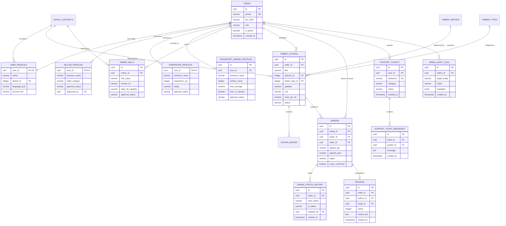

# 🌲 TIMORA™ — Kerala's Smart Timber Marketplace
### *Connecting Timber, People & Possibilities across God's Own Country*

[](https://timorah.me)
[](https://api.timorah.me/api/v1)
[](https://vitest.dev/)
[](https://www.typescriptlang.org/)
[](https://supabase.com/)
[](LICENSE)

---

**TIMORA™** is an end-to-end digital marketplace, timber volume calculation engine, and logistics compliance bridge built specifically for Kerala's native timber economy. By eliminating speculative middlemen and informal brokerage, TIMORA directly connects verified residential and commercial buyers, individual agricultural tree growers, licensed sawmill depots, master wood joiners (*ആശാരിമാർ*), and certified heavy transit operators across all 14 districts of Kerala.

The platform provides transparent cubic-foot (CFT) pricing, authentic Kerala Quarter-Girth Hoppus calculations, multi-role compliance moderation, and verified Forest Department Form IV transit permits.

---

## 1. 🏗️ Tech Stack & Architecture

TIMORA™ is architected as a high-performance, modular monorepo powered by **Turborepo** and **npm workspaces**, delivering an instantaneous single-page application experience coupled with a serverless Express microservice backend.

```
┌────────────────────────────────────────────────────────────────────────┐
│                        CLIENT LAYER (SPA)                              │
│   React 18 · Vite 6 · Tailwind CSS · Lucide Icons · TanStack Query     │
│       Bilingual i18n Engine (English & Malayalam / മലയാളം)             │
└───────────────────────────────────┬────────────────────────────────────┘
                                    │
                         HTTPS / JSON REST API
                        (Strict 15m JWT Session)
                                    │
┌───────────────────────────────────▼────────────────────────────────────┐
│                       SERVERLESS BACKEND LAYER                         │
│     Node.js · Express.js · TypeScript · Vercel Serverless Functions    │
│    Argon2id PIN Auth · Zod Validation · Pino Logger · Rate Limiters    │
└───────────────────────────────────┬────────────────────────────────────┘
                                    │
                         PostgreSQL Wire Protocol
                           (Connection Pooling)
                                    │
┌───────────────────────────────────▼────────────────────────────────────┐
│                         PERSISTENCE LAYER                              │
│       PostgreSQL 15+ (Supabase / Neon Cloud) · Row-Level Cascades      │
│      Relational Multi-Role Profiles · Audit Logs · Inventory Ledger    │
└────────────────────────────────────────────────────────────────────────┘
```

### Core Technologies

| Layer | Technologies & Tools | Architectural Purpose |
| :--- | :--- | :--- |
| **Frontend Web Client** | **React 18.3**, **Vite 6.0**, **TypeScript 5.7**, **Tailwind CSS 3.4**, **Lucide React**, **TanStack React Query v5**, **Axios** | High-speed Single-Page Application (SPA) with zero-redundancy mobile viewports, responsive layouts, and PWA capabilities. |
| **Backend REST API** | **Node.js 18+**, **Express.js 4.21**, **TypeScript**, **Argon2**, **jsonwebtoken**, **Zod**, **Helmet**, **Pino** | Serverless function runtime on Vercel handling multi-role RBAC, inventory mutations, grievance queues, and audit trails. |
| **Database & Storage** | **PostgreSQL** (Supabase / Neon), **pg (node-postgres)** connection pool, **Supabase Cloud Storage** | Relational ACID data store with row-level constraints, indexed geo-lookups, and secure S3-compatible image buckets. |
| **Deployment & Hosting** | **Vercel Edge & Serverless Platform**, Custom Domain DNS, Automatic SSL | Dual independent deployments for client and API with customized routing rewrites and zero cold-start caching headers. |
| **Internationalization** | **Bilingual Native i18n Engine** (English & Malayalam) | In-memory language toggle preserving native timber terms (*തേക്ക്*, *മഹാഗണി*, *ആഞ്ഞിലി*, *ഈട്ടി*, *ഹോപ്പസ് സി.എഫ്.ടി*). |

---

## 2. 👥 Multi-Role Dashboard Ecosystem

TIMORA™ implements strict Role-Based Access Control (RBAC) across six dedicated actor dashboards. Authenticating with a registered Kerala mobile number (`+91 XXXXXXXXXX`) and 6-digit security PIN dynamically directs users to their role-specific workspace.

```
                               ┌───────────────┐
                               │ TIMORA™ Auth  │
                               │ Mobile + PIN  │
                               └───────┬───────┘
                                       │
        ┌──────────────┬───────────────┼───────────────┬──────────────┐
        ▼              ▼               ▼               ▼              ▼
┌──────────────┐┌──────────────┐┌──────────────┐┌──────────────┐┌──────────────┐
│ Verified     ││ Individual   ││ Timber Mill  ││ Master       ││ Transporter  │
│ Buyer        ││ Seller       ││ Owner        ││ Carpenter    ││ Owner        │
│ Dashboard    ││ Dashboard    ││ Dashboard    ││ Dashboard    ││ Dashboard    │
└──────────────┘└──────────────┘└──────────────┘└──────────────┘└──────────────┘
                                       │ (Admin Role)
                                       ▼
                               ┌───────────────┐
                               │ Super Admin   │
                               │ Regulatory    │
                               │ Cell Console  │
                               └───────────────┘
```

### 1. Verified Buyer Dashboard (`/dashboard/buyer`)
* **Live Timber Procurement**: Browse vetted raw round logs, sawn timber planks, and square trusses with transparent CFT pricing.
* **Order Lifecycle & Delivery Confirmation**: Real-time order progress tracking (`Awaiting Confirmation` $\rightarrow$ `Transit Dispatched` $\rightarrow$ `Delivered`). Includes one-click **"Confirm Delivery Received"** mutation updating the ledger and releasing review privileges.
* **Grievance Redressal**: File support tickets with image evidence and view administrative resolution notes.
* **Artisan & Transit Directory Booking**: Directly request quotes from master joiners and licensed crane lorries.

### 2. Individual Timber Seller Dashboard (`/dashboard/seller`)
* **Farmstead & Estate Listing Studio**: Publish timber lots (Teak, Mahogany, Anjili, Rubberwood) with girth, length, and district tags.
* **Inquiry Management**: Receive, evaluate, and counter buyer volume offers in real time.
* **Sales Ledger & Batch Tracking**: Monitor active, completed, and archived tree harvests.

### 3. Timber Mill / Sawmill Owner Dashboard (`/dashboard/mill`)
* **Depot Batch Management**: Ingest rough timber logs and log processed sawn timber planks and squared beams.
* **Live Stock Reconciliation**: Instant volume deduction upon order confirmation to prevent accidental overselling.
* **Sawmill Credentials Showcase**: Display government sawmill licenses (e.g. `KL-SAW-EKM-1048`), heavy band saw counts, and daily CFT capacity.

### 4. Master Carpenter / Artisan Dashboard (`/dashboard/carpenter`)
* **Craftsmanship Showcase**: Display traditional Kerala roof truss joinery (*തച്ചുശാസ്ത്രം* / Nalukettu trusses), custom doors, and hand-carved panels.
* **Client Work Requests**: Accept or decline custom project briefs from residential builders and heritage property renovators.
* **Verified Artisan Badge**: Admin-audited verification ensuring authentic master craftsman credentials.

### 5. Transporter / Logistics Owner Dashboard (`/dashboard/transport`)
* **Timber Transit Manifests**: Log vehicle fleet (hydraulic crane carriers, heavy lorries) with Kerala registration numbers.
* **Form IV Compliance Gate**: Ensure all active transit assignments possess valid Kerala Forest Department Form IV transit permits.
* **Haulage Dispatch Management**: Update consignment statuses from mill pickup to destination timber depot or buyer site.

### 6. Super Admin Console (`/admin`)
* **Multi-Role Regulatory Verification**: Audit pending business credentials across Individual Sellers, Sawmills, Artisans, and Transporters. One-click Approve, Request Additional Documents, or Reject with audit reasons.
* **Listing Quality Inspection**: Inspect raw timber listings, cross-check species validity, verify photo authenticity, and censor non-timber consumer products (e.g. finished furniture, plywood).
* **Audit Trail & System Monitoring**: Immutable administrative action log tracking actor, target entity, timestamp, and notes.

---

## 3. ✨ Key Engineering & UX Highlights

### 🆔 Memorable Identity System (`TMR-[ROLE]-[XXXX]`)
Raw 36-character database UUIDs (e.g., `701321e1-55ed-4867-b551-12c301a22470`) have been eliminated from all user-facing interfaces. TIMORA™ dynamically formats deterministic, memorable identity badges using role classification and registration entropy:

$$\text{User ID} = \mathbf{TMR}\text{-}[\text{ROLE\_CODE}]\text{-}[\text{4\_CHARS}]$$

* **Master Carpenter**: `TMR-CRP-2247`
* **Verified Buyer**: `TMR-BYR-7044`
* **Individual Seller**: `TMR-SLR-3001`
* **Timber Mill Owner**: `TMR-MIL-1200`
* **Transport Provider**: `TMR-TRN-4400`
* **Super Admin**: `TMR-ADM-0001`

### ⏱️ Strict 15-Minute Session Security
* **Automated Client-Side Idle Timeout**: Monitors DOM interaction events (`mousemove`, `keydown`, `touchstart`, `scroll`). After **15 minutes of inactivity**, the active session is cleared, local authentication state is destroyed, and a modal prompts re-authentication.
* **Synchronized Backend JWT Expiration**: All signed authentication tokens enforce `expiresIn: '15m'`, guaranteeing that stale or compromised tokens cannot access serverless endpoints.

### 👤 Standardized 3-Action Profile Menu
The top-right user menu is standardized across every authenticated role to strictly three core destinations:
1. **My Dashboard** — Instant routing to the user's role-specific command center.
2. **Edit Profile & Settings** — Dedicated modal allowing profile updates, clean 10-digit phone inspection, and district adjustments.
3. **Sign Out** — Secure session revocation with confirmation guard.

### 📞 Strict 10-Digit Phone Number Normalization
To prevent inconsistent telephone formatting across user roles and form submissions, TIMORA™ enforces a strict 10-digit numeric standard (`XXXXXXXXXX`):
* **Visual Layer Sanitization**: Leading country codes (`+91` or `+91 `) are systematically stripped across profile header badges, user avatars, account edit modals, and "Raise a Support Ticket" dialogs via the shared `formatCleanPhone()` utility.
* **Locked & Read-Only Pre-fills**: In support modals and profile inspection badges, authenticated contact numbers are locked in clean 10-digit format, preventing manual user tampering.
* **Schema Integrity**: Preserves underlying E.164 database compatibility while delivering a uniform domestic UX across all 14 districts of Kerala.

### ✕ Admin Solution Reply Reactive Dismissal
When Super Admin resolves an escalated grievance, the official solution is surfaced directly in the user's dashboard via an "ADMIN SOLUTION REPLY" announcement card:
* **One-Click Dismissal**: Users can dismiss the solution card via an active top-right close action (`✕`).
* **Persistent Local Synchronization**: The dismissal state is remembered across page refreshes and browser tabs using `localStorage` synchronization (`timora_dismissed_ticket_ids` and `timora_dismissed_admin_reply_${role}`).
* **Zero History Loss**: Dismissing the highlight banner preserves the complete chronological ticket history and resolution record in the user's ticket table below.

### ⚡ Optimized Network Architecture & Debounced Polling
Following comprehensive systems auditing, high-frequency network overhead has been systematically eliminated:
* **Keystroke Debouncing**: Marketplace search queries (`GET /listings?search=...`) use a 300ms debounce timer to prevent burst HTTP calls during rapid typing.
* **Tab-Aware Notification Polling**: Dashboard notification intervals check `document.hidden` and throttle polling to 45 seconds, eliminating phantom background requests when tabs are idle.
* **Auth Session Deduplication**: Burst calls to `GET /auth/me` during multi-component mounting are debounced with a 3-second guard window in `AuthContext`.

### 📱 Strict Mobile Navigation Guard (`< 768px`)
* **Zero Visual Redundancy**: Redundant top-bar navigation links and duplicate auth buttons are hidden on mobile viewports (`hidden md:flex`), leaving only the TIMORA™ brand mark and language toggle.
* **Fixed Mobile Bottom Navigation**: High-contrast, ergonomic bottom action bar for instantaneous switching between Marketplace, CFT Calculator, Service Directories, and User Account.
* **Gesture & History Guard**: Uses `overscroll-behavior-x: none` and route-trapped UI navigation (`useStrictUINavigation`) to eliminate accidental browser back-swipe exits.

### 📐 Kerala Standard Hoppus Rule CFT Calculator
Implements the authentic formula specified by the Kerala Forest Department and PWD:

$$\text{Round Log Volume (CFT)} = \left(\frac{G}{4}\right)^2 \times \frac{L}{144}$$

$$\text{Sawn Beam Volume (CFT)} = \frac{L \times W \times T}{144} \times N$$

*Where:*
* $G$ = Mid-girth (circumference) in inches
* $L$ = Length of log in feet
* $W$ = Width in inches, $T$ = Thickness in inches
* $N$ = Number of identical sawn pieces

---

## 4. 🔄 Level-1 Data Flow Diagram (DFD)

The Level-1 Data Flow Diagram models the decomposition of the TIMORA™ ecosystem into five primary operational processes, mapping interactions between external human actors, functional system boundaries, and persistent database stores:

```mermaid
flowchart TD
    %% External Entities
    subgraph Entities ["External Actors"]
        E1["👤 Verified Buyer"]
        E2["🌲 Seller / Sawmill"]
        E3["🪓 Master Carpenter"]
        E4["🚚 Transporter"]
        E5["🛡️ Super Admin"]
    end

    %% Processes
    subgraph Processes ["Functional Subsystems"]
        P1["1.0<br/>Authentication &<br/>Session Security"]
        P2["2.0<br/>Timber Cataloging &<br/>Hoppus CFT Engine"]
        P3["3.0<br/>Order Fulfillment &<br/>Stock Deduction"]
        P4["4.0<br/>Grievance Redressal &<br/>Solution Dispatch"]
        P5["5.0<br/>Regulatory Audit &<br/>Role Verification"]
    end

    %% Data Stores
    subgraph Stores ["PostgreSQL Data Stores"]
        D1[("D1: User & Role Registry<br/>(users, profiles)")]
        D2[("D2: Timber Inventory Ledger<br/>(timber_listings, mills)")]
        D3[("D3: Transactions Ledger<br/>(orders, history, reviews)")]
        D4[("D4: Grievance Store<br/>(support_tickets, messages)")]
        D5[("D5: Regulatory Audit Log<br/>(admin_audit_logs)")]
    end

    %% Flows for P1
    E1 & E2 & E3 & E4 & E5 -->|"Mobile + PIN"| P1
    P1 <-->|"Verify Hash / PIN"| D1
    P1 -->|"15m JWT Session Token"| E1 & E2 & E3 & E4 & E5

    %% Flows for P2
    E2 -->|"Log Measurements (G, L, W, T)"| P2
    P2 -->|"Calculate CFT & Persist"| D2
    D2 -->|"Filtered Marketplace Feed"| P2
    P2 -->|"Browse Verified Lots"| E1

    %% Flows for P3
    E1 -->|"Initiate Purchase Order"| P3
    P3 <-->|"Reserve Stock / Decrement CFT"| D2
    P3 -->|"Record Order Status"| D3
    E2 -->|"Accept & Dispatch Transit"| P3
    E1 -->|"Confirm Delivery Received"| P3
    P3 -->|"Completed Order Receipt"| E1 & E2

    %% Flows for P4
    E1 & E2 & E3 & E4 -->|"Raise Support Ticket"| P4
    P4 -->|"Store Ticket & Attachments"| D4
    D4 -->|"Escalated Grievance Queue"| P4
    P4 -->|"Inspect & Author Solution"| E5
    E5 -->|"Publish Admin Reply"| P4
    P4 -->|"Dismissible Admin Solution Banner"| E1 & E2 & E3 & E4

    %% Flows for P5
    E2 & E3 & E4 -->|"Submit Business Licenses / Form IV"| P5
    P5 -->|"Update Approval Status"| D1
    E5 -->|"Audit Listings & Business Credentials"| P5
    P5 -->|"Write Immutable Event"| D5
```



### Data Flow Process Specifications

| Process | Inputs | Outputs | Interacting Stores | Description |
| :--- | :--- | :--- | :--- | :--- |
| **1.0 Auth & Session Security** | Mobile No, 6-digit PIN, Registration Details | 15-min JWT token, Memorized Identity (`TMR-XXX`), Role Context | **D1: User Registry** | Authenticates users using Argon2id key derivation, issues time-bounded JWT sessions, and locks 10-digit phone identity. |
| **2.0 Timber Cataloging & CFT Engine** | Mid-girth ($G$), Length ($L$), species, pricing, sawmill specs | Validated listing record, Hoppus CFT volume, Marketplace feed | **D2: Inventory Ledger** | Computes standardized quarter-girth volume, validates species compliance, and indexes active stock. |
| **3.0 Order Fulfillment & Stock Deduction** | Volume selection, delivery acceptance, buyer confirmation | Order state transitions, inventory deduction, settlement receipts | **D2: Inventory**, **D3: Orders** | Prevents overselling by decrementing stock upon order creation, tracks dispatch, and captures final delivery acknowledgment. |
| **4.0 Grievance Redressal & Redirection** | Support ticket subject, category, description, evidence photo | Admin reply cards, persistent ticket records, status alerts | **D4: Grievance Store** | Facilitates dispute resolution with cross-dashboard dismissible alert banners and persistent localStorage synchronization. |
| **5.0 Regulatory Audit & Verification** | Sawmill licenses, master joiner portfolios, vehicle permits | Verified merchant badges, permit clearances, audit entries | **D1: User Registry**, **D5: Audit Log** | Enforces Kerala Forest Produce Transit Rules 1975, audits sawmill licenses, and tracks all admin mutations. |

---

## 5. 📁 Project Structure (Active Web App Only)

```text
mcakju_timber_new/
├── package.json                         # Monorepo configuration (Turborepo + npm workspaces)
├── turbo.json                           # Pipeline execution definitions (build, dev, test)
│
├── apps/
│   ├── web/                             # ACTIVE FRONTEND CLIENT
│   │   ├── index.html                   # HTML entrypoint with PWA headers
│   │   ├── package.json                 # Web dependencies (React, Vite, Tailwind, TanStack Query)
│   │   ├── vite.config.ts               # Vite configuration (PWA plugin, asset optimization)
│   │   ├── vercel.json                  # Client rewrite rules (SPA routing & asset headers)
│   │   └── src/
│   │       ├── main.tsx                 # React DOM mount point & chunk error listeners
│   │       ├── App.tsx                  # Root router, AppHeader, UserNavMenu, strict auth guard
│   │       ├── index.css                # Tailwind directives & responsive layout utilities
│   │       ├── components/              # UI Components
│   │       │   ├── BackButton.tsx       # Trapped back navigation button
│   │       │   ├── BrandLogo.tsx        # High-res SVG brand identity mark
│   │       │   ├── EditProfileModal.tsx # Universal profile editor & phone formatter
│   │       │   ├── SessionTimeoutModal  # 15-minute inactivity timeout countdown
│   │       │   ├── SignOutConfirmModal  # Safe sign-out confirmation dialog
│   │       │   └── ...                  # Review, ticket, and status modals
│   │       ├── pages/                   # Application Pages & Role Dashboards
│   │       │   ├── admin/               # Super Admin verification & audit console
│   │       │   ├── auth/                # Login & Registration pages
│   │       │   ├── buyer/               # Verified Buyer order & procurement dashboard
│   │       │   ├── carpenter/           # Master Carpenter dashboard & public directory
│   │       │   ├── seller/              # Individual Seller & Timber Mill dashboards
│   │       │   ├── transport/           # Transporter dashboard & haulage directory
│   │       │   └── public/              # Marketplace, Calculator, Detail & Mill pages
│   │       ├── context/
│   │       │   └── AuthContext.tsx      # Authentication state, 15m timer, role switching
│   │       ├── hooks/
│   │       │   └── useStrictUINavigation # UI-trapped history navigation guard
│   │       ├── lib/
│   │       │   └── api.ts               # Axios client with JWT interceptor & demo handlers
│   │       └── utils/
│   │           ├── ticketService.ts     # Client ticket persistence & dispatch
│   │           └── timberListings.ts    # Listing queries and status filters
│   │
│   └── api/                             # ACTIVE SERVERLESS REST API
│       ├── api/
│       │   └── index.ts                 # Vercel Serverless Function entrypoint
│       ├── package.json                 # Backend dependencies (Express, Argon2, pg, Zod)
│       ├── vercel.json                  # Serverless function rewrite rules (/(.*) -> /api)
│       └── src/
│           ├── app.ts                   # Express application factory, CORS, rate limiting
│           ├── index.ts                 # Local development server bootstrapper
│           ├── config/
│           │   └── database.ts          # PostgreSQL connection pool (pg.Pool)
│           ├── db/
│           │   ├── migrate.ts           # Migration executor
│           │   ├── migrations/          # Versioned SQL migrations (001 - 004)
│           │   └── seed.ts              # Idempotent demo database seeder
│           ├── middleware/
│           │   ├── auth.ts              # JWT verification & 15m expiration validator
│           │   ├── rbac.ts              # Role-Based Access Control validator
│           │   └── errorHandler.ts      # Global centralized error handler
│           └── modules/                 # Modular Domain Controllers & Routes
│               ├── admin/               # Approvals, pending seller applications
│               ├── auth/                # PIN verification, registration, OTP challenges
│               ├── listings/            # Timber lot CRUD, species validation
│               ├── orders/              # Order state transitions, delivery confirmation
│               └── support/             # Grievance ticket redressal system
│
└── packages/
    └── shared/                          # SHARED UTILITY & TYPINGS PACKAGE
        ├── package.json                 # @timora/shared package manifest
        └── src/
            ├── index.ts                 # Main exports
            ├── types/                   # Shared TypeScript interfaces & enums
            └── utils/
                ├── calculator.ts        # Hoppus rule CFT mathematical formulas
                ├── formatters.ts        # TMR-ROLE-XXXX and clean 10-digit phone formatters
                └── validation.ts        # Shared Zod validation schemas
```

---

## 6. 🗄️ Relational Entity-Relationship (ER) Diagram

The diagram below reflects the active PostgreSQL relational schema operating in production:



---

## 7. ⚙️ Environment Variables & Configuration

### Frontend Client Configuration (`apps/web/.env`)

```env
# Base URL for the Express REST API backend
# Local Development:
VITE_API_URL=http://localhost:3001/api/v1

# Production Deployment:
# VITE_API_URL=https://api.timorah.me/api/v1
```

### Backend API Configuration (`apps/api/.env`)

```env
# Server Runtime
NODE_ENV=development
PORT=3001
LOG_LEVEL=info

# Cross-Origin Resource Sharing (Comma-separated allowed domains)
CORS_ORIGINS=http://localhost:5173,https://timorah.me,https://www.timorah.me,https://timora-rho.vercel.app,https://timora.vercel.app

# PostgreSQL Cloud Database Connection
DATABASE_URL=postgresql://postgres:[PASSWORD]@[HOST]:5432/[DB_NAME]?sslmode=require
DATABASE_SSL=true

# Authentication & Session Security (Strict 15m)
JWT_SECRET=super-secure-production-random-secret-key-min-32-chars
JWT_ACCESS_EXPIRES=15m
JWT_REFRESH_EXPIRES=7d

# Argon2id PIN Hashing Parameters
ARGON2_MEMORY=65536
ARGON2_ITERATIONS=3
ARGON2_PARALLELISM=4

# Supabase Storage (Timber Listing Images)
SUPABASE_URL=https://[YOUR_PROJECT_ID].supabase.co
SUPABASE_SERVICE_ROLE_KEY=[YOUR_BACKEND_SERVICE_ROLE_KEY]
SUPABASE_STORAGE_BUCKET=timber-listings
IMAGE_MAX_SIZE_BYTES=10485760

# OTP Configuration
OTP_DEMO_MODE=true
OTP_EXPIRY_SECONDS=300
OTP_MAX_ATTEMPTS=3
```

---

## 8. 🚀 Getting Started & Local Development

### Prerequisites
* **Node.js**: `v18.0.0` or later (LTS recommended)
* **npm**: `v9.0.0` or later
* **PostgreSQL**: Local instance or remote cloud database (Supabase / Neon)

### 1. Clone the Repository & Install Dependencies
```bash
# Clone the repository
git clone https://github.com/rohancherian2003/Timora.git
cd Timora

# Install all workspace dependencies from root
npm install
```

### 2. Configure Environment Files
```bash
# Set up backend environment
cp .env.example apps/api/.env

# Set up frontend environment
cp apps/web/.env.example apps/web/.env
```
*(Ensure `DATABASE_URL` in `apps/api/.env` points to a live PostgreSQL database).*

### 3. Initialize Database Migrations & Seed Data
```bash
# Build the shared utility library first
npm run build -w @timora/shared

# Execute PostgreSQL schema migrations
npm run db:migrate

# Seed demo profiles for all roles (Buyer, Sellers, Carpenters, Transporters, Admin)
npm run db:seed
```

### 4. Run Development Servers Concurrently
```bash
# Starts both frontend (Vite :5173) and backend (Express :3001) concurrently via Turborepo
npm run dev
```
* **Web Client**: [http://localhost:5173](http://localhost:5173)
* **REST API**: [http://localhost:3001/api/v1](http://localhost:3001/api/v1)

### 5. Execute Test Suite
```bash
# Run all unit and integration tests across all workspaces
npm test

# Run workspace-specific tests
npm test --workspace=apps/web
npm test --workspace=apps/api
npm test --workspace=packages/shared
```

### 6. Production Compilation
```bash
# Typecheck and compile production assets
npm run build
```

---

## 9. 🌐 Deployment & Vercel Configuration

TIMORA™ is optimized for zero-maintenance serverless deployment on **Vercel** across two distinct projects (Frontend SPA and Backend API).

### Frontend Routing (`apps/web/vercel.json`)
```json
{
  "rewrites": [
    {
      "source": "/api/:match*",
      "destination": "https://api.timorah.me/api/:match*"
    },
    {
      "source": "/(.*)",
      "destination": "/index.html"
    }
  ],
  "headers": [
    {
      "source": "/index.html",
      "headers": [{ "key": "Cache-Control", "value": "no-cache, no-store, must-revalidate" }]
    },
    {
      "source": "/assets/(.*)",
      "headers": [{ "key": "Cache-Control", "value": "public, max-age=31536000, immutable" }]
    }
  ]
}
```

### Backend Serverless Routing (`apps/api/vercel.json`)
```json
{
  "version": 2,
  "rewrites": [
    {
      "source": "/(.*)",
      "destination": "/api"
    }
  ]
}
```

### Custom Domain DNS Configuration
To route your branded domain (`timorah.me` / `api.timorah.me`) to the Vercel edge network:
* **Root Web Domain (`timorah.me` / `@`)**: Add a DNS `A` record pointing to `76.76.21.21`.
* **Subdomains (`www` or `api`)**: Add DNS `CNAME` records pointing to `cname.vercel-dns.com`.
* **SSL Certificates**: Provisioned and renewed automatically via Vercel Let's Encrypt CA integration.

---

## 10. 🛡️ Security & Regulatory Compliance

### Authentication & Token Security
* **Argon2id Key Derivation**: User PINs are hashed using memory-hard Argon2id (`memoryCost: 65536`, `iterations: 3`). Plaintext PINs are never persisted or logged.
* **JWT Token Sanitization**: User identity tokens carry strict `15m` validity windows, signing only non-sensitive claims (`userId`, `role`).
* **Connection Security**: Cloud database access requires SSL encryption (`sslmode=require`), rejecting plaintext network traffic.

### Kerala Forest Produce Transit Rules (1975) Compliance
TIMORA™ embeds statutory forestry compliance directly into its digital workflows:
* **Form IV Transit Clearance**: Transporters registered on TIMORA must declare clearance under the *Kerala Forest Produce Transit Rules, 1975*.
* **Permit Attachment**: Timber consignments moving across Kerala revenue districts support attaching Forest Department Form IV transit permits, enabling real-time inspection at forest check-posts.
* **Species Categorization**: Native reserved species (Nilambur Teak, Rosewood/Veetti, Sandalwood) are flagged for mandatory transit passes before dispatch orders are approved.

---

## 11. 📄 License & Attribution

TIMORA™ — Kerala's Smart Timber Marketplace. Proprietary software. All rights reserved.  
Engineered for Kerala's timber growers, sawmillers, wood artisans, and builders.
